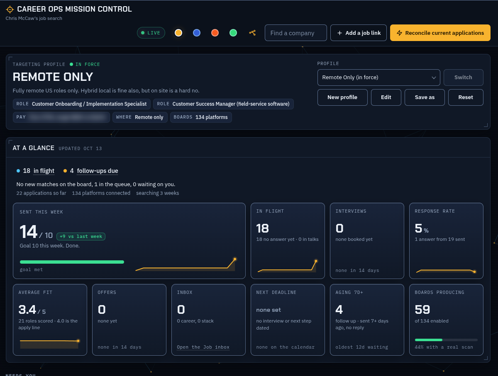

# Career Ops Mission Control

A personal job search system: a local web dashboard plus the automation behind it. It finds jobs, scores them, writes a tailored resume and cover letter for each one, fills in the online application, and tracks every reply.

I built it in October 2026 by directing AI coding tools (Claude Code and OpenAI Codex). I am a landscape business owner and former construction foreman moving into customer onboarding and operations work, and this is how I run my own search.



## What it does

- **Dashboard.** One local page shows targeting rules, applications sent this week against a goal, what is in flight, replies, interviews, an apply queue and a mission log. It updates live while it is open.
- **Job scan.** `scan_boards.py` reads the public job APIs of 140+ company boards (Greenhouse, Lever, Ashby, SmartRecruiters) plus remote job sites, keeps fully remote US roles in my lanes above my pay floor, and flags postings that have closed.
- **Application packets.** For each job, a tailored resume and cover letter are built from one master resume (DOCX and PDF, 2 pages), and `make_packet.py` writes the form answers and adds the job to the apply queue.
- **Spell check.** `spellcheck.py` checks every resume, letter and written answer before anything is sent.
- **Twice a day.** A scheduled run scans for jobs, prepares and submits applications whose answers are already known, asks me only new questions as cards on the dashboard, and logs employer replies. It stops at interviews, sign-ins, puzzles and agreements.

## How it is built

| Part | What it is |
| --- | --- |
| `pieces/` | The page, in small HTML, CSS and JavaScript pieces. `build/make.py` assembles them into one file. |
| `server.py` | A small Python server, bound to 127.0.0.1 only, that serves the page and a JSON document store with live updates. |
| `cmc.py`, `cmcdb.py` | A command line for the same store: add jobs, move statuses, log events. Safe to use while the page is open. |
| `launch.sh` | Start, stop and check the server. |
| `test/` | A click-test matrix across screen sizes and themes, a page audit and a color contrast check. |
| `docs/PALETTE.md` | The color system: every color is a token, checked for contrast in light and dark. |

## Run it

```bash
bash launch.sh            # start the server and open the page
python3 cmc.py list applications
python3 scan_boards.py --check
```

The database, resumes, answers and job folders live outside this repository. Nothing personal is committed here.
